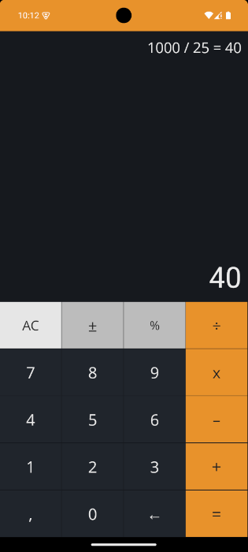

# 🧮 Basic Calculator

A simple, modern, and user-friendly calculator application built with **.NET MAUI**, following the **MVVM architecture**.

Basic Calculator provides essential mathematical operations through a clean, single-page interface.

<p align="center">
  
  &nbsp;&nbsp;&nbsp;&nbsp;
  
</p>

## ✨ Features

- ➕ Basic arithmetic operations (Addition, Subtraction, Multiplication, Division)
- 🔢 Decimal number support
- ➖ Positive and negative number conversion
- 💯 Percentage calculations
- ⌫ Delete the last entered digit
- 🧹 Clear all input and calculations
- 🧮 Expression evaluation with NCalc
- 🎯 MVVM architecture for clean code organization

## 🛠️ Technologies

| Technology | Description |
|---|---|
| C# | Main programming language |
| .NET MAUI | Cross-platform UI framework |
| XAML | User interface design |
| MVVM | Application architecture |
| CommunityToolkit.Mvvm | Observable properties and commands |
| NCalc | Mathematical expression evaluation |

## 🏗️ Architecture

The application follows the **Model-View-ViewModel (MVVM)** pattern.

- **View:** XAML-based user interface.
- **ViewModel:** `BasicCalcViewModel` handles application logic and user interactions.
- **Commands:** Implemented using `RelayCommand` from CommunityToolkit.Mvvm.
- **Data Binding:** Implemented using `ObservableObject` and `ObservableProperty`.

## 📂 Project Structure

```text
BasicCalculator/
│
├── Platforms/
│   ├── Andorid/
│   ├── MacCatalyst/
│   ├── Tizen/
│   ├── Windows/
│   └── iOS/
│
├── Properties/
│   └── launchSettings.json
│
├── Resources/
│   ├── AppIcon/
│   ├── Fonts/
│   ├── Splash/
│   └── Styles/
│
├── ViewModels/
│   └── BasicCalcViewModel.cs
│
├── Views/
│   ├── BasicCalcPage.xaml
│   └── BasicCalcPage.xaml.cs
│
├── App.xaml
├── App.xaml.cs
├── BasicCalculator.csproj
└── MauiProgram.cs
```

## 🚀 Getting Started

### Prerequisites

- Visual Studio 2022 or later
- .NET SDK compatible with the project
- .NET MAUI workload

### Installation

1. Clone the repository:

   ```bash
   git clone https://github.com/musabkaranfil/.netmaui-basiccalculator.git
   ```

2. Navigate to the project directory:

   ```bash
   cd BasicCalculator
   ```

3. Restore NuGet packages:

   ```bash
   dotnet restore
   ```

4. Open the solution in Visual Studio.

5. Select your target platform and run the application.


## 🧠 Implementation Highlights

The application uses **NCalc** to dynamically evaluate mathematical expressions represented as strings.

Instead of manually implementing mathematical operations, NCalc parses the string expression, interprets it as a mathematical expression, and evaluates it to produce the result.

For example, a mathematical expression such as `"25 + 10 * 2"` can be evaluated directly:

```csharp
string input = "25 + 10 * 2";

// Convert the string into a mathematical expression
Expression expression = new Expression(input);

// Evaluate the expression
object result = expression.Evaluate();

Console.WriteLine(result); // 45
```

In the application, user inputs are combined into a single expression and evaluated dynamically:

```csharp
Expression += Input;

string correctedString = Expression.Replace(',', '.');

// Parse and evaluate the mathematical expression
Expression expression = new Expression(correctedString);
object result = expression.Evaluate()!;

Input = result.ToString()!;
```

This approach allows the calculator to evaluate mathematical expressions dynamically while keeping the calculation logic simple and maintainable.

The **CommunityToolkit.Mvvm** library is used for observable properties and commands, reducing boilerplate code and keeping the ViewModel clean.

## 🤝 Contributing

Contributions, suggestions, and bug reports are welcome!

Feel free to fork this repository, create a branch, and submit a pull request.

## 📄 License

This project is open-source. Add a license file to the repository if you intend to distribute it under a specific license.
